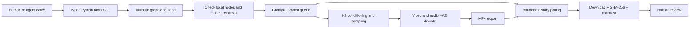

# Autonomous Media Studio

**A local synthetic-media workflow, from a reproducible H3 graph to a reviewable video.**

This technical showcase accompanies an a16z Speedrun application. It captures a working slice of a larger local media studio: Python orchestration, a ComfyUI H3 graph, asynchronous GPU execution, and an artifact that can be inspected and checked against its original run record.

[](examples/environment/output.mp4)

**[Watch the actual generated clip](examples/environment/output.mp4)** · [Inspect the exact input graph](examples/environment/workflow.json) · [Check the evidence](benchmarks/README.md)

The included clip is an environment-only generation: 352 × 608, 124 frames at 24 fps, with AAC stereo audio. It was produced locally before this repository was assembled. Its SHA-256 and the source graph's SHA-256 both match the original August 11, 2026 benchmark report. The video depicts a synthetic architectural scene; it is not footage of an actual visit.

## Why this exists

Generating a clip is only one part of a useful media workflow. The surrounding software needs to preserve the exact inputs, distinguish queued work from completed work, fail visibly, collect outputs, and leave enough evidence for a person to review the result.

The contribution here is that orchestration layer and the local workflow configuration. H3, ComfyUI, its node implementations, and the model weights are external components, not models developed for this repository.

## Architecture



The checked-in graph uses an H3 FL2VA checkpoint through a `MiniMaxH3ImageToVideo` node, without a first-frame image attached. It contains Qwen text conditioning, 12 sampling steps, video/audio decoding, and MP4 export. The class name alone should not be read as evidence that this particular example uses an image input.

## Try it without a GPU

Python 3.10+ is sufficient for the control plane. There are no runtime Python dependencies.

```sh
python -m pip install -e .
media-studio plan
python -m unittest discover -s tests -v
python benchmarks/verify.py
```

`plan` prints the compiled graph and makes no network requests. Tests use a fake backend and never fabricate a demo video. `verify.py` checks the committed workflow and video hashes; if FFprobe is installed, it also validates media properties.

## Render on your local installation

Use an existing ComfyUI installation exposing the H3 node classes and exact model filenames listed in the graph. Model weights are deliberately not included. Installation details and compatibility caveats are in [the demo guide](docs/DEMO.md).

```sh
media-studio preflight --endpoint http://127.0.0.1:8188
media-studio render --out runs/environment-001 --seed 170911
```

The render command submits one job, polls its history, downloads MP4 outputs, and writes the submitted graph plus a manifest containing hashes, sizes, job ID, and client wall time. An existing output directory is rejected. Timeout stops local waiting; it does not cancel the server's GPU job. Check that job before trying again.

An agent can invoke `plan_render` and `render_local` from `media_studio.agent_tools`. The `Backend` protocol makes submission, history, and download replaceable. This release has no bundled LLM planner or autonomous social posting. Every generated output remains subject to human review.

## What is verified

| Evidence | Status |
| --- | --- |
| Original workflow and output | Both hashes match the historical run report |
| Output media | Fully decoded; 352 × 608, 124 frames, 24 fps, H.264 + AAC stereo |
| Historical render time | Report says 96.03 seconds; raw timing log unavailable, not independently remeasured |
| Historical GPU | Report identifies RTX 5070 Ti 16 GB; not a peak-memory measurement |
| New wrapper | Tested with simulated job histories; no new live GPU render claimed |
| Identity preservation / production quality | Not demonstrated by this environment-only example |

See [benchmark evidence and limitations](benchmarks/README.md). No peak VRAM, throughput average, speedup, or cost claims are made.

## Repository map

```text
src/media_studio/   graph preparation, backend interface, job lifecycle, agent tools, CLI
examples/          original graph, real local output, preview
benchmarks/        checksum evidence, media probe, verification script
tests/             lifecycle and validation tests without a GPU
docs/              demo instructions and provenance
```

The original local smoke runner and graph predate this showcase. The package structure, preflight checks, artifact collection, manifest handling, and tests were added during curation. [Provenance](docs/PROVENANCE.md) distinguishes that work from the historical render.

Genabra application code, credentials, private identity/reference media, customer data, analytics, and model weights are excluded. No open-source license is granted in this repository; external components remain subject to their own licenses.
